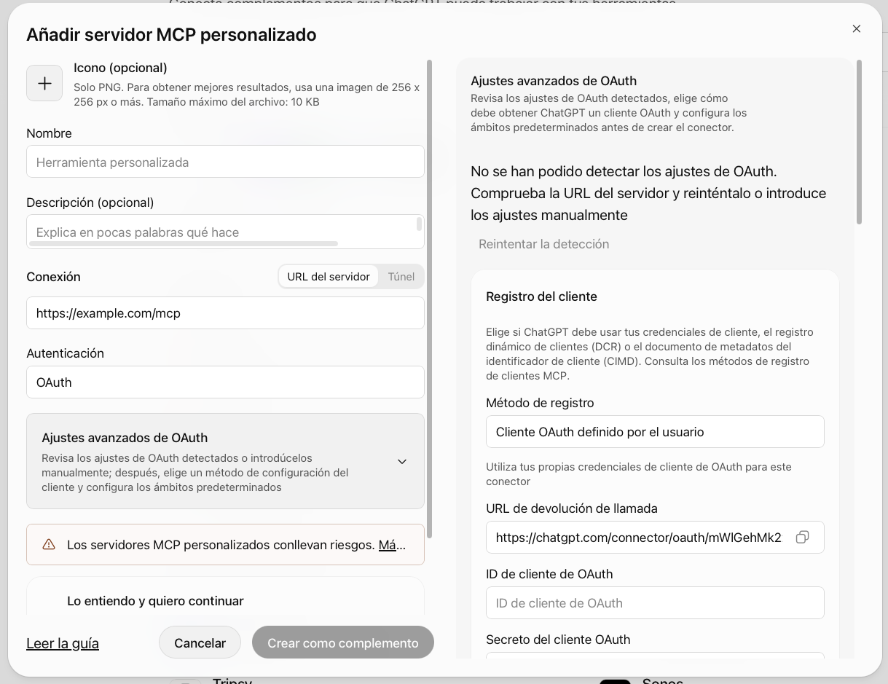
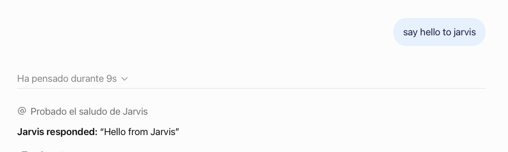

# Contributing to Jarvis

This guide covers the setup and workflow for contributing to Jarvis: accessing
AWS, connecting the application to ChatGPT and Claude, and developing, testing,
and submitting changes from your own Git branch.

## Request access

Before getting started, contact Alex, the project maintainer
([@alexdlp](https://github.com/alexdlp)), to request access. Include your GitHub
username, the email address you want to use for Jarvis, and a short description
of what you would like to work on.

Alex will arrange repository access, your personal AWS credentials, and the
account and connection details needed to use the existing Jarvis deployment.
Exchange credentials privately; do not post them in GitHub issues or pull
requests.

## 1. Set up AWS access

The maintainer will provide a personal IAM user in the `jarvis_devs` group and
its two credentials: an **Access Key ID** and a **Secret Access Key**. Each
contributor uses their own credentials.

Install [AWS CLI v2](https://docs.aws.amazon.com/cli/latest/userguide/getting-started-install.html)
and check that it is available:

```bash
aws --version
```

Save your credentials in a local profile named `jarvis`. This keeps any
credentials you use for other projects separate:

```bash
aws configure --profile jarvis
```

Enter the following values when prompted:

| Field | Value |
| --- | --- |
| AWS Access Key ID | Your personal Access Key ID |
| AWS Secret Access Key | Your personal Secret Access Key |
| Default region name | `eu-west-1` |
| Default output format | `json` |

Select that profile for commands in this terminal:

```bash
export AWS_PROFILE=jarvis
aws sts get-caller-identity
```

The response should identify your IAM user and the Jarvis AWS account. Check
these against the details supplied by the maintainer before deploying.
Run `export AWS_PROFILE=jarvis` again whenever you open a new terminal; you do
not need to enter your keys again.

AWS stores the keys in `~/.aws/credentials` and configuration in `~/.aws/config`,
outside the repository. Do not copy keys into project files, commits,
screenshots, or chats. If they are exposed, notify the maintainer so they can
be replaced. See the
[AWS profile documentation](https://docs.aws.amazon.com/cli/latest/userguide/cli-configure-files.html).

These credentials are used by AWS CLI and Terraform. They do not sign you into
the AWS website and are not passwords for ChatGPT, Claude, or Jarvis.

## 2. Get the existing Jarvis connection details

Install Git, Make, and Terraform 1.10 or later. Open a terminal and clone the
repository:

```bash
git clone https://github.com/alexdlp/jarvis.git
cd jarvis
```

If you already have a clone, open its directory instead. With any previous work
saved, select `main` and the AWS profile configured in step 1:

```bash
git switch main
export AWS_PROFILE=jarvis
```

From the repository root, initialize Terraform and print the deployment outputs:

```bash
make init
make outputs
```

`make init` initializes Terraform using the existing `main` workspace, then
selects or creates the workspace for your current Git branch. `make outputs`
prints the saved outputs for that branch without modifying its infrastructure.
Here, with `main` checked out, it prints the main Jarvis connection details.

Use the following values to configure ChatGPT and Claude:

| Detail | Purpose |
| --- | --- |
| MCP URL (`mcp_url`) | The Jarvis HTTPS address, ending in `/mcp` |
| ChatGPT Client ID (`cognito_chatgpt_client_id`) | Identifies the ChatGPT connector |
| Claude Client ID (`cognito_claude_client_id`) | Identifies the Claude connector |

Client IDs are public identifiers, not secret keys. Both clients are configured
without a Client Secret: leave that field empty.

Your Jarvis sign-in credentials are not Terraform outputs. You create the
account in step 3, or the maintainer may have created it for you in advance.
This account lets you use the application, while your IAM user lets you work
with AWS. Use the same Jarvis account in ChatGPT and Claude when connecting to
the same deployment.

## 3. Create your Jarvis account

Connecting to Jarvis requires a Jarvis account in that deployment. It is
separate from your AWS credentials: the IAM user lets you deploy, while the
Jarvis account is the identity you sign in with inside ChatGPT and Claude.

With `main` checked out and the AWS profile exported, run from the repository
root:

```bash
make create-user EMAIL=you@example.com
```

The command asks for a password of at least 12 characters, including uppercase
and lowercase letters, numbers, and symbols, and creates the account in the
deployment's Cognito user pool. Run it once per deployment; creating the same
user twice fails. If the maintainer already created your account, skip this
step.

## 4. Connect Jarvis to ChatGPT

In ChatGPT on the web, open [Plugins](https://chatgpt.com/plugins), select **+**,
and choose **Add custom MCP server**. Availability depends on your account or
workspace permissions. Menu labels may change as ChatGPT is updated.



Configure the connection with these values:

| Field | Value |
| --- | --- |
| Name | `Jarvis` |
| Server URL | The full MCP URL, including `/mcp` |
| Authentication | OAuth |
| OAuth Client ID | The `cognito_chatgpt_client_id` value from `make outputs` |
| OAuth Client Secret | Leave empty |

Use the existing OAuth client; Jarvis does not register clients automatically.
Review the connection notice and create the plugin. Install it in your account
to use it in a conversation. These steps follow
[OpenAI's MCP connection guide](https://developers.openai.com/api/docs/guides/custom-mcp-server).

### Authorize the redirect URL

When you create the connector, ChatGPT generates a redirect URL that it uses to
send you back after sign-in. Cognito only returns an authorization code to
callback URLs registered in advance, so ChatGPT's exact URL must be added to the
ChatGPT client's allowlist. This is the link between ChatGPT and Terraform.

The client is `aws_cognito_user_pool_client.chatgpt`; its allowlist is
`callback_urls` in `infra/cognito.tf`. Open that block and add the URL ChatGPT
shows you, keeping the entries already there:

```hcl
callback_urls = [
  "https://chatgpt.com/connector/oauth/0NtCRcad5iLR", # existing; keep it
  "https://chatgpt.com/connector/oauth/<id-chatgpt-shows-you>",
]
```

Cognito matches callback URLs exactly, so copy the URL without changes. On
`main`, send it to the maintainer instead of applying the change yourself. On
your own branch, edit the file and run `make plan` and `make apply`; see
[Connect ChatGPT and Claude to your branch](#connect-chatgpt-and-claude-to-your-branch)
for that flow.

Until the URL is added, sign-in fails with `redirect_mismatch`. Do not run
`make apply` on `main` to resolve this, and do not copy another contributor's
URL. OpenAI documents this requirement in its
[authentication guide](https://developers.openai.com/plugins/build/auth#redirect-url).

Once the URL is authorized, complete the connection by entering your **Jarvis**
email and password on the sign-in page that opens. Do not enter AWS keys in the
connector.

## 5. Connect Jarvis to Claude

In Claude on the web, open **Customize > Connectors**, select **+ Add**, and
choose **Add custom connector**. Enter `Jarvis` as the name and the same MCP URL.

Continue to the authentication options:

| Field | Value |
| --- | --- |
| Authentication | OAuth / **Sign in now** |
| OAuth client | **Use your own OAuth client** |
| Client ID | The `cognito_claude_client_id` value from `make outputs` |
| Client Secret | Leave empty |

If your interface shows **Advanced settings**, enter the OAuth client details
there. Do not select automatic registration or add AWS keys as request headers.

Add the connector and sign in with your Jarvis account. If a **Connect** button
appears, select it to start authentication. For team accounts, your Claude
administrator may need to add the connector first. See
[Claude's connector guide](https://support.claude.com/en/articles/11175166-get-started-with-custom-connectors-using-remote-mcp).

Terraform already declares `https://claude.ai/api/mcp/auth_callback` as the
redirect URL for this client. These instructions cover Claude on the web;
Claude Code is a separate client and is outside this walkthrough.

## 6. Verify both connections

In ChatGPT, open a conversation and select the Jarvis plugin using `@`.
In Claude, enable Jarvis through **+ > Connectors** in the conversation.

Ask each client:

> Use Jarvis's hello tool and show me its response.



Check that the tool actually runs and returns `Hello from Jarvis`. This check
does not create tasks or modify data. A text response without a tool call does
not verify the connection.

Once both connections work, continue below to develop a new feature.

## 7. Set up the repository

Run the commands below in a Bash or Zsh terminal, from the repository you cloned
in step 2. On Windows, use a compatible environment such as WSL.

You need Git, Make, Terraform 1.10 or later, Python 3.13 or later, `uv`, and `jq`,
in addition to AWS CLI. Terraform must also use the provider versions pinned
in the repository.

```bash
uv sync --locked
export AWS_PROFILE=jarvis
```

GitHub access is separate from AWS access. You need repository permissions to
push your branches.

## 8. Create a branch and deploy its resources

With your previous work saved, update `main` and create a branch:

```bash
git switch main
git pull --ff-only
git switch -c feature/my-feature
```

Use lowercase letters and numbers, with single hyphens between words. You can
use `/` to separate parts of the name, as in `feature/my-feature`.
Do not use spaces, underscores, uppercase letters, or double hyphens. The name
`default` is reserved.

The script converts `/` to `--` to identify the deployment. For example,
`feature/my-feature` uses the `feature--my-feature` workspace. The current limit
is 41 characters after that conversion. Do not rename a branch while it has
active resources: a different name selects a different deployment.

```bash
make init
make plan
make apply
```

`make init` prepares Terraform and selects or creates your branch's state.
`make plan` shows the proposed changes. `make apply` calculates them again and
asks for confirmation before executing them. The last two commands also
package the application code.

All branches use the same Terraform configuration. Resources with branch-based
names receive their suffix, and each workspace keeps its own state in S3.
You do not need to enter ARNs or create IAM roles.

Contributors work on branches; changes to the infrastructure, roles, and
permissions of `main` are managed by the maintainer. Branches are not isolated
from other contributors: do not modify someone else's resources or state.

### Connect ChatGPT and Claude to your branch

Create your account in the branch's Jarvis deployment and retrieve its details:

```bash
make create-user EMAIL=you@example.com
make outputs
```

The first command asks for a password of at least 12 characters, including
uppercase and lowercase letters, numbers, and symbols. Run it once per user
and deployment; do not repeat it if the user already exists.

Create additional connections in ChatGPT and Claude with a name that identifies
the branch, such as `Jarvis — my-feature`. Repeat the connection instructions
using the values from this branch:

- `mcp_url` as the server address.
- `cognito_chatgpt_client_id` for ChatGPT.
- `cognito_claude_client_id` for Claude.
- The Jarvis account you just created in this branch.

Do not use `api_url` without `/mcp` or combine a Client ID from `main` with a
branch URL. Jarvis accounts from `main` are not copied to branches.

For ChatGPT, check the new connector's redirect URL. If it is not authorized,
add it to `callback_urls` in `aws_cognito_user_pool_client.chatgpt` in your
branch's `infra/cognito.tf`, then run `make plan` and `make apply` again.
Preserve the existing URLs. Highlight this change in your pull request so the
URLs that should remain in `main` can be reviewed.

Select your branch's connection when testing changes. Keep the main connection
for using the existing Jarvis deployment.

### Develop, verify, and share changes

After changing code, run the local tests:

```bash
uv run pytest tests/unit
```

The test in `tests/integration` uses AWS and writes to the branch's deployed
table. Run it only when you intend to check that integration:

```bash
uv run pytest tests/integration
```

To test updated code from ChatGPT or Claude:

```bash
make plan
make apply
make logs MINUTES=15
```

If the available tools change, refresh their list through the connector's
management interface. Group related changes into commits and push your branch:

```bash
git status
git add path/to/file
git commit -m "Describe the change"
git push -u origin feature/my-feature
```

Replace `path/to/file` and the branch name with your own. Open a pull request
against `main` and describe what changed and how you verified it.

### Remove resources when you finish

While you are still on the branch you deployed:

```bash
git branch --show-current
make destroy
```

Check that the plan refers to your branch before confirming. Its resources
will be deleted, including the table and Jarvis users for that deployment.
Disconnect its ChatGPT and Claude connectors as well.

Do this before deleting or renaming the branch. Deleting a Git branch or merging
a pull request does not remove AWS resources or stop their costs. `make destroy`
does not itself delete the workspace or its state file.

## Troubleshooting

| Problem | What to check |
| --- | --- |
| AWS cannot find credentials | Run `export AWS_PROFILE=jarvis` in that terminal. |
| AWS identifies a different account or user | Check the profile and whether `AWS_ACCESS_KEY_ID`, `AWS_SECRET_ACCESS_KEY`, or `AWS_SESSION_TOKEN` variables from another project are set; they can override the profile. Do not share their values. |
| A command returns `AccessDenied` | Send the maintainer the action and resource from the error, without keys or tokens. Do not broaden permissions or use someone else's credentials. |
| ChatGPT returns `redirect_mismatch` | The connector's exact redirect URL must be authorized in the corresponding Cognito client. |
| A connector fails to authenticate | Check the URL ending in `/mcp`, the correct Client ID, and that your Jarvis account belongs to that deployment. |
| The option to add connectors is missing | Check availability and permissions for your ChatGPT or Claude account. |
| Terraform cannot find the branch's workspace | Run `make init` from that branch before using the other commands. |
| GitHub rejects a push | Check which GitHub account you are authenticated as and its repository permissions; AWS keys do not authenticate you to GitHub. |
