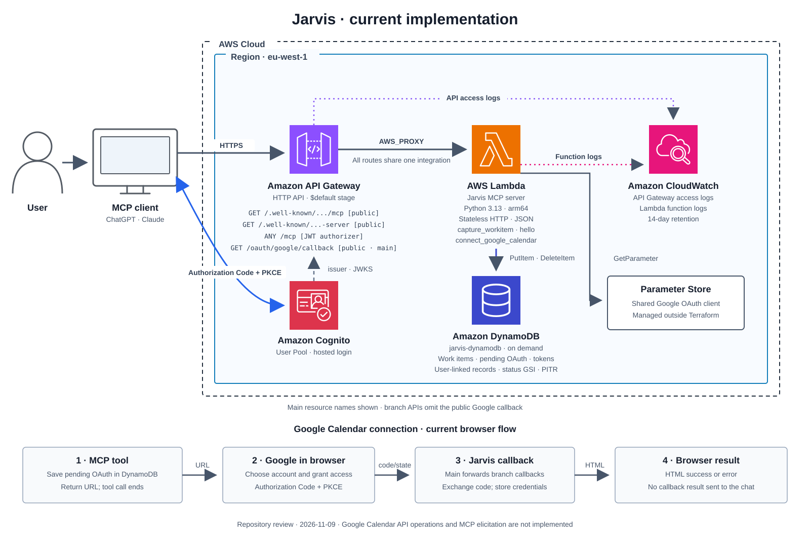

# Jarvis

Jarvis is an intelligent task and time management system designed to turn conversations into realistic, actionable plans.

The goal is to provide a conversational interface through which users can manage their tasks, organize their time, and plan their day or week intelligently.

Jarvis should be able to answer questions such as:

* What do I have scheduled for tomorrow?
* I need to complete tasks A, B, and C. Help me estimate how long they will take and schedule them throughout the week.
* My boss has scheduled an urgent meeting for tomorrow. How should I reorganize the tasks I had planned for that day?

Jarvis runs on AWS and exposes its capabilities through the [Model Context Protocol](https://modelcontextprotocol.io). This makes the conversational interface deliberately interchangeable: any MCP-compatible agent can connect to Jarvis, and Jarvis neither knows nor needs to know which agent is calling it.

Jarvis owns the task state, planning logic, scheduling decisions, and external integrations.


## Architecture



An MCP client connects in three steps, and the split between the protected MCP
route and the two public discovery routes is the part worth understanding:

1. **Discover.** The client calls `/mcp` with no token and API Gateway refuses it. The refusal carries no hint about where to authenticate — a JWT authorizer is a managed component and its `401` cannot be customised — so the client falls back to reading a metadata document at a conventional path. That document names the authorization server. It is the only place the link between this API and its user pool is written down, and it is served without authentication by necessity: a client with no token has to be able to read it, or it would need a token to discover how to obtain one.
2. **Log in.** The client opens the user pool's hosted login in a browser and the user authenticates. OAuth 2.0 Authorization Code with PKCE; no machine-to-machine grant, so every connection involves a real person once. Access tokens last an hour and refresh tokens thirty days.
3. **Call tools.** Requests to `/mcp` carry a bearer token. API Gateway validates the signature, issuer and audience before invoking Lambda, so a request rejected by the authorizer never reaches application code.

The MCP and discovery routes resolve to the same Lambda function. The `main`
deployment also exposes a public Google OAuth callback at
`GET /oauth/google/callback`; it can forward the callback to the branch that
started authorization. The MCP SDK and its custom Starlette routes dispatch by
path internally. See
[`docs/architecture.md`](docs/architecture.md) for the complete request flows,
configured AWS resources, IAM boundaries, persistence design, deployment path,
failure behaviour, and current limitations.

## What runs today

| Piece | Detail |
| --- | --- |
| Front door | API Gateway HTTP API. Throttled at 10 burst / 5 rps, shared across all routes |
| Compute | Lambda on Python 3.13 / arm64, running the official `mcp` SDK over Mangum |
| Transport | Streamable HTTP, stateless, JSON responses — no SSE, no server-side sessions |
| Identity | Cognito user pool. Administrator-created users only, no self-registration |
| Authorization | API Gateway JWT authorizer on `ANY /mcp`; both metadata routes and the Google callback in `main` stay public |
| Storage | DynamoDB table `jarvis-dynamodb`; on-demand billing, per-user keys, a `status` GSI, and 35-day point-in-time recovery |
| Google OAuth | Authorization Code + PKCE; shared client configuration in Parameter Store, pending requests and user credentials in DynamoDB; result shown in the browser |
| Observability | CloudWatch Logs for the function, plus API Gateway access logs that record requests the authorizer rejected before any invocation |
| Tools | `capture_workitem`, `hello`, and `connect_google_calendar`, which returns a Google authorization URL |
| Deployment state | Terraform S3 backend with encryption and lock files; workspace selected from the Git branch |

## Running it

The Makefile supplies the AWS region and selects the Terraform workspace for
the current Git branch. Run `make` with no target for the command list. See
[CONTRIBUTING.md](CONTRIBUTING.md) for access, setup, connector configuration,
and branch deployment instructions.

```sh
make init                              # initialize the backend and select/create the branch workspace
make plan                              # preview changes
make apply                             # create or update
make create-user EMAIL=you@example.com # bootstrap a user; not idempotent, kept out of apply
make list-users
make list-db
make logs MINUTES=15
make outputs
make url
make destroy
```

`make destroy` targets the current branch's workspace and removes the resources
managed there, including its user pool and DynamoDB table. Cognito users
are created through the AWS CLI rather than declared as resources, so they never
appear in a plan and an apply does not bring them back. Separate workspace state
does not guarantee separate resource names: `infra/dynamodb.tf` currently uses
the fixed table name `jarvis-dynamodb` in every workspace. The Lambda execution
roles and shared Google OAuth parameter are managed outside this Terraform
configuration.

## Updating the diagram

The README renders `assets/architecture.svg` directly. Keep it in sync with the
current-state document at `docs/architecture.md` when the deployed architecture
changes.

## Planned

Jarvis can capture and persist work items. The following capabilities are not
built yet:

- Read, organize, update, complete, and delete captured work.
- Prioritize work using deadlines, importance, effort, and available time.
- Turn priorities into practical time blocks instead of leaving them as a flat task list.
- Read availability from Google Calendar and schedule focused work around existing commitments.
- Complete Google authorization through MCP URL elicitation and automatically report its outcome in the chat.
- Reschedule unfinished tasks when plans change.
- Surface overdue work, scheduling conflicts, and unrealistic workloads.
- Support daily planning, weekly reviews, and progress tracking.

The intended shape keeps the language model as the interface and reasoning layer without making it the source of truth: a task and planning engine owns the business rules, a store keeps state and history, and Google Calendar provides real availability and receives approved time blocks. State changes, permissions, validation, and integrations stay in the application.

## Project status

Jarvis is in early development.

Authenticated capture and persistent storage are implemented. Google OAuth
connection is also implemented: `connect_google_calendar` returns an
authorization link, and the callback stores credentials and displays the result
in the browser. MCP elicitation, automatic continuation in the chat, token
refresh, Calendar API operations, retrieval and editing tools, and the planning
engine remain to be implemented. The architecture document distinguishes the
current repository review from the older AWS verification snapshot.
