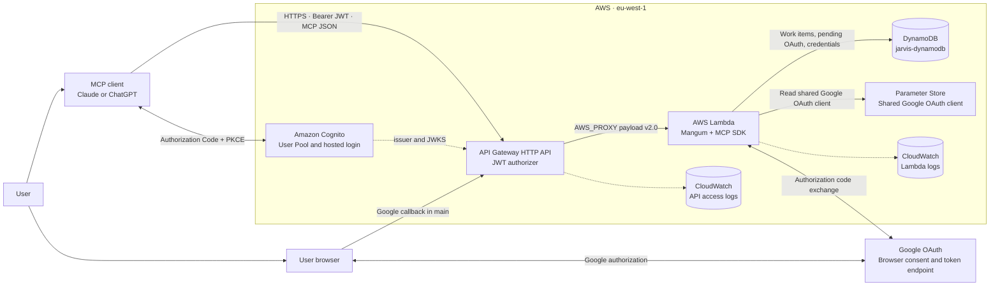
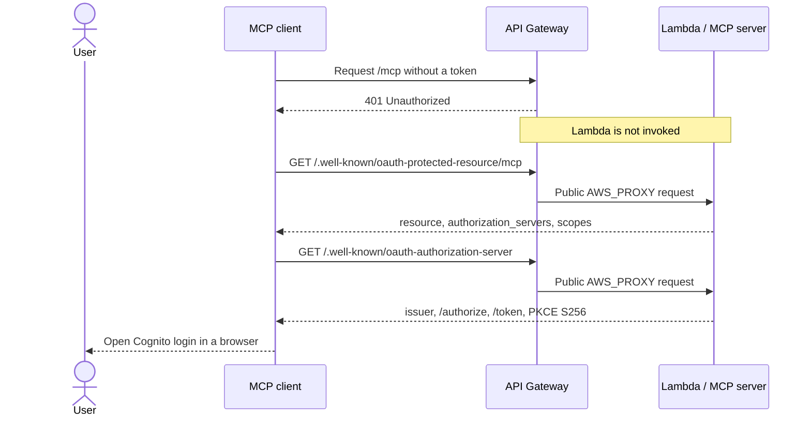
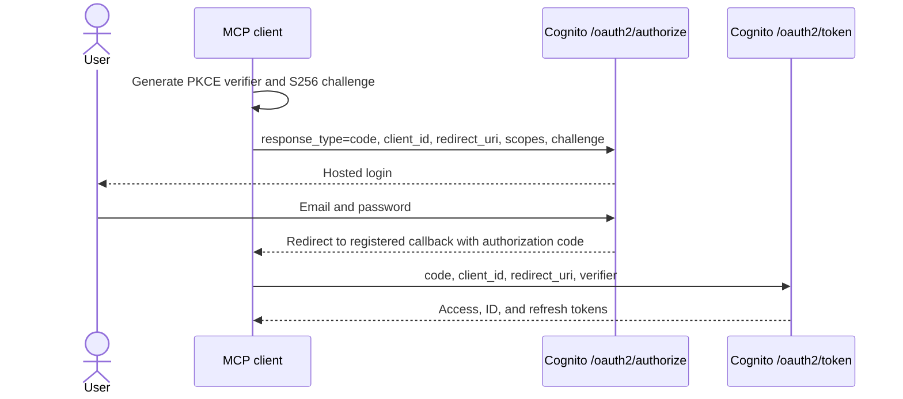
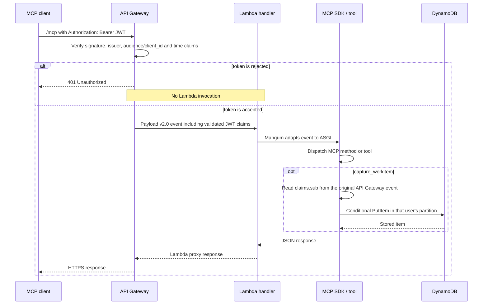
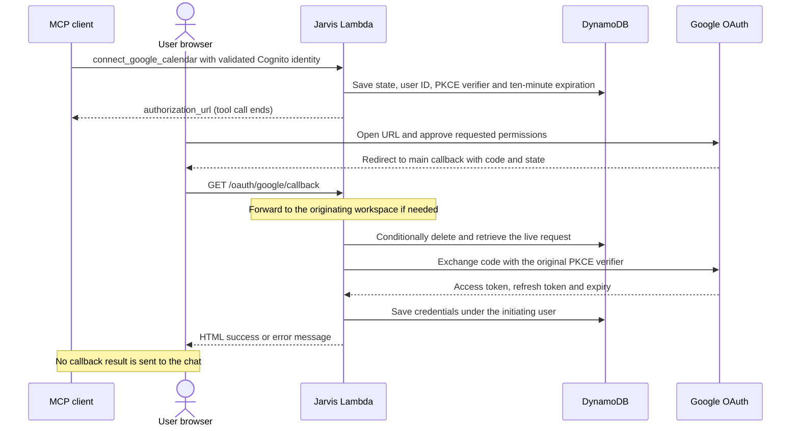
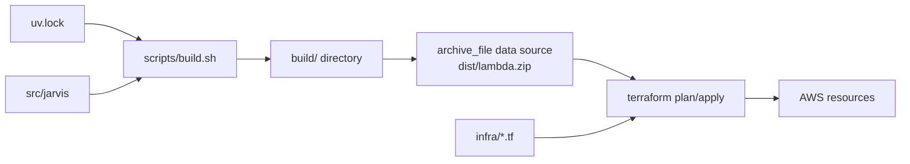

# Jarvis architecture

This document describes the implementation and Terraform configuration reviewed
in the repository on 2026-11-09. It is not a target-state design or a fresh audit
of the running AWS deployment. The earlier AWS verification snapshot from
2026-10-10 is retained at the end and does not verify later changes.

## System summary

Jarvis is a remote, authenticated Model Context Protocol (MCP) server. Each
deployment defines one AWS Lambda function. Clients such as Claude and ChatGPT
authenticate human users through Amazon Cognito, send JSON requests to an Amazon API Gateway
HTTP API, and receive synchronous JSON responses. API Gateway validates the JWT
before invoking Lambda. Lambda runs the MCP SDK, dispatches a tool call, and the
`capture_workitem` tool persists the authenticated user's item in DynamoDB.
`connect_google_calendar` returns a Google authorization URL; a separate browser
callback exchanges the authorization code and stores that user's credentials.
The OAuth result is displayed in the browser. No elicitation or automatic chat
continuation is implemented.

The current system is deliberately stateless at the transport layer. There are
no MCP sessions, no SSE response streams, no background workers, and no state in
Lambda memory that correctness depends on. DynamoDB is the application source
of truth.



## Configured inventory

| Layer | Current resource and configuration |
| --- | --- |
| Region | `eu-west-1`, controlled by `REGION` in the Makefile |
| Public endpoint | API Gateway generated `execute-api` hostname; no custom domain |
| API | HTTP API `jarvis-api<suffix>`, `$default` stage, automatic deployment |
| API limits | Shared stage token bucket: burst 10, sustained 5 requests/second |
| Authentication | API Gateway JWT authorizer backed by Cognito |
| Identity | Cognito user pool `jarvis-users<suffix>`; administrator-created users only |
| OAuth clients | Separate public clients for Claude and ChatGPT; Authorization Code + PKCE |
| Compute | Lambda `jarvis-mcp-server<suffix>`; Python 3.13, arm64, 512 MB, 30-second timeout |
| Transport | MCP Streamable HTTP in stateless, JSON-response mode |
| Storage | DynamoDB table `jarvis-dynamodb`, on-demand billing, one `status` GSI |
| Recovery | DynamoDB point-in-time recovery for 35 days; TTL enabled on `expires_at` |
| Google OAuth configuration | Shared Parameter Store parameter `jarvis-google-oauth-client`, read with decryption; managed outside Terraform |
| Lambda execution role | Existing `jarvis-mcp-server-role` in `main`; shared `jarvis-mcp-server-dev-role` in other workspaces |
| Logs | Separate API Gateway and Lambda log groups, both retained for 14 days |
| Provisioning | Terraform with an encrypted S3 backend and lock files; branch workspaces; packaging and operations through the Makefile |

`<suffix>` is empty for `main` and `-<workspace>` for other workspaces. The
workspace name is derived from the Git branch, replacing `/` with `--`.
The DynamoDB table name is currently fixed as `jarvis-dynamodb`, without that
suffix. Separate Terraform states therefore do not establish separate tables.

## Public HTTP surface

Each API Gateway deployment exposes the MCP route and two discovery routes.
`main` additionally exposes the Google callback, for four routes in total;
other workspaces have three API routes. All routes use the same Lambda proxy
integration in their deployment and payload format 2.0. The application routes
the request after it reaches Starlette.

| Route | Authentication | Purpose |
| --- | --- | --- |
| `ANY /mcp` | JWT required | All MCP protocol traffic |
| `GET /.well-known/oauth-protected-resource/mcp` | Public | Names the protected resource, authorization server, scope, and bearer-token method |
| `GET /.well-known/oauth-authorization-server` | Public | Proxies the Cognito issuer, authorize endpoint, token endpoint, grants, and PKCE method into metadata the MCP clients can discover |
| `GET /oauth/google/callback` | Public; `main` only | Receives the browser's Google authorization response and forwards it to the originating workspace when needed |

An unmatched route is handled by API Gateway and does not invoke Lambda. The
well-known routes must remain public: a client without credentials needs them to
discover how to obtain credentials.

The protected-resource document identifies the MCP URL as the resource and the
API origin as its authorization server. The second document then points to the
Cognito issuer and Cognito hosted-domain endpoints. This extra metadata layer is
why a client can begin with only the `/mcp` URL even though the API Gateway and
Cognito hostnames are unrelated.

Source: [`infra/api_gateway.tf`](../infra/api_gateway.tf) and
[`src/jarvis/interface/well_known.py`](../src/jarvis/interface/well_known.py).

## End-to-end flows

### 1. OAuth discovery



API Gateway's managed JWT rejection is a plain `401`; the Lambda cannot add a
body or `WWW-Authenticate` header because rejected requests never reach it. MCP
clients therefore discover the protected-resource document at its conventional
well-known path.

### 2. User login and token issuance



Both app clients are public: they have no client secret. Cognito accepts only
the authorization-code OAuth flow for these clients, and PKCE S256 protects code
redemption. The requested application scope is `jarvis-mcp/tasks` alongside
`openid`, `email`, and `profile`.

Token lifetimes are explicit in Terraform:

- access token: 1 hour;
- ID token: 1 hour;
- refresh token: 30 days;
- refresh-token revocation: enabled.

Claude and ChatGPT have separate Cognito app clients and callback allowlists.
They share the user pool, resource server, API Gateway, Lambda, and data. Keeping
the app clients separate allows one integration's refresh tokens to be revoked
without revoking the other integration's tokens.

The user pool accepts email as the sign-in attribute. Public self-registration
is disabled, email is marked verified by the provisioning script, and users are
created administratively with `make create-user EMAIL=...`. MFA is currently
off, and there are no external identity providers or authentication triggers.

Source: [`infra/cognito.tf`](../infra/cognito.tf) and
[`scripts/create-user.sh`](../scripts/create-user.sh).

### 3. Authenticated MCP request



API Gateway fetches Cognito's public signing keys from the issuer and validates
the JWT before invocation. It passes the decoded claims in
`requestContext.authorizer.jwt.claims`. Mangum retains the original event in the
ASGI scope, and `get_authenticated_user_id()` reads the immutable Cognito `sub`
claim from that trusted location. There is intentionally no user ID tool
argument: model-generated input cannot select a different user's partition.

Source: [`src/jarvis/interface/identity.py`](../src/jarvis/interface/identity.py).

### 4. Google Calendar connection

Google authorization is separate from the Cognito login that lets an MCP client
call Jarvis. Jarvis acts as the OAuth client of Google and keeps Google's tokens
on the server.



`state` has the form `<workspace>.<random nonce>`. The shared Google client
configuration supplies one registered redirect URI. Only `main` exposes the
callback through API Gateway. A successful callback from another workspace is
forwarded synchronously to that workspace's Lambda using the original API
Gateway event. The destination processes its own request; `main` relays its
HTML response to the browser. Workspace names are validated before forwarding,
and only `main` may forward to another deployment.

Google is asked for `https://www.googleapis.com/auth/calendar.events.owned`,
offline access and explicit consent. The callback consumes the request before
the token exchange, rejects missing/expired/reused state, and requires a refresh
token before saving credentials. Opening the authorization URL is not evidence
that a connection has been saved.

Rejections currently return HTML before validating or forwarding `state`. They
do not consume the pending request. Exchange or storage failures after
consumption also return HTML without retaining an attempt result. The callback
does not verify the browser's Jarvis identity against the initiating user.
These are implementation limits, not completed elicitation features.

Source: [`google_calendar.py`](../src/jarvis/interface/tools/google_calendar.py),
[`google_callback.py`](../src/jarvis/interface/google_callback.py),
[`google_oauth.py`](../src/jarvis/integrations/google_oauth.py), and
[`infra/google_calendar.tf`](../infra/google_calendar.tf).

## Lambda and MCP runtime

The locked runtime contains MCP SDK 2.2.0, Mangum 0.22.0, and Pydantic 2.13.4.
The handler performs two adaptations:

1. API Gateway event to ASGI request through Mangum;
2. ASGI request to MCP protocol handling through the MCP SDK's Starlette app.

`build_starlette_server()` creates a new `MCPServer` and Starlette application
for every invocation. This is required because Mangum drives ASGI lifespan on
each invocation and the SDK's session manager cannot be run twice. The DynamoDB
resource object is different: it is created lazily and cached for reuse by warm
Lambda environments.

The transport settings are load-bearing:

- `stateless_http=True`: Jarvis does not issue an `Mcp-Session-Id` and does not
  rely on one Lambda invocation reaching the same execution environment as the
  next request;
- `json_response=True`: every MCP request receives one JSON response instead of
  an SSE stream;
- DNS rebinding protection is disabled in the SDK because API Gateway supplies
  its own host name, not `127.0.0.1`; access control remains at API Gateway.

This is why Lambda and an API Gateway HTTP API work for the current tools. The
architecture does not support unsolicited server-to-client messages, resumable
MCP sessions, progress streams, or other behaviour that requires a long-lived
connection or shared session store.

Source: [`src/jarvis/lambda_handler.py`](../src/jarvis/lambda_handler.py) and
[`src/jarvis/interface/server.py`](../src/jarvis/interface/server.py).

## Tools implemented today

The server registers exactly three tools on every invocation.

### `capture_workitem`

Creates and persists a work item. The SDK derives the tool schema from the
function signature, enum types, Pydantic field descriptions, and docstring.

| Input | Type | Default | Meaning |
| --- | --- | --- | --- |
| `title` | non-empty string | required | Short name in the user's words |
| `kind` | `idea`, `task`, `project` | `task` | What kind of work it is |
| `status` | `inbox`, `active`, `parked`, `done`, `cancelled` | `inbox` | Lifecycle state |
| `importance` | `low`, `normal`, `high` | `normal` | User-judged importance, not urgency |
| `description` | string or null | null | Detail that does not fit the title |
| `deadline` | date or null | null | Due date, not scheduled execution time |
| `estimate_minutes` | positive integer or null | null | User-provided or clearly implied estimate |
| `tags` | string list or null | empty list | Free-form labels |
| `parent_id` | string or null | null | Existing parent item identifier |

The tool builds a `WorkItem`, obtains the user ID from the validated JWT, writes
through `WorkItemRepository`, logs only item ID and status, and returns the
serialized item. It deliberately avoids logging title, description, and tags.

### `hello`

Returns `Hello from Jarvis`. It is the original end-to-end health tool and does
not read identity or storage.

### `connect_google_calendar`

Starts Google OAuth for the authenticated Cognito user, saves a temporary request
in DynamoDB and returns `{"authorization_url": "..."}`. The verifier remains on
the server. This is a normal final tool result containing a link; there is no
URL elicitation, pending MCP call, completion notification or calendar API call.

No work-item read, list, update, complete or delete tools, planning or scheduling
operations, or Google Calendar event operations exist yet.

Source: [`src/jarvis/interface/tools`](../src/jarvis/interface/tools).

## Persistence and tenant separation

### Write path

`WorkItemRepository.create()` maps a domain object to DynamoDB attributes and
uses one conditional `PutItem`:

```text
attribute_not_exists(pk) AND attribute_not_exists(sk)
```

This makes create-only semantics explicit and prevents an ID collision from
overwriting an existing item. DynamoDB conditional failures become
`WorkItemAlreadyExists`; other AWS or transport failures become
`PersistenceError`. There is no retry, idempotency record, or custom MCP error
mapping yet.

### Base-table keys

```text
pk = U#<Cognito sub>
sk = ITEM#<work item id>
```

Every user's items share one logical base-table partition. Ownership is derived
from the validated token, not stored in the domain model and not accepted from
the client.

### Status index

The `status` global secondary index supports lifecycle queries:

```text
status_pk = U#<sub>#open      for inbox, active, parked
          = U#<sub>#closed    for done, cancelled

status_sk = <status>#<ordering date>
```

Inbox items order by creation time, active and parked items by deadline, and
closed items by completion/update time. Undated open work uses `9999-12-31` so
it remains in the index and sorts after dated work. The index projection carries
list-view fields but omits the potentially unbounded `description`.

Work-item persistence currently uses only `PutItem`. Google OAuth additionally
uses a conditional `PutItem` for the pending request, a conditional `DeleteItem`
with `ALL_OLD` to consume it, and a `PutItem` to save credentials. Lambda IAM
policies are managed outside this repository; their effective permissions are
not established by this source review.

The detailed schema, access patterns, ordering rules, and reserved key space are
documented in [`docs/data-model.md`](data-model.md).

### Google OAuth records

| Record | Partition key | Sort key | Stored data |
| --- | --- | --- | --- |
| Pending authorization | `OAUTH#GOOGLE#<state>` | `REQUEST` | Initiating Cognito user ID, private PKCE verifier, `expires_at` |
| User's Google connection | `U#<Cognito sub>` | `INT#google` | Access token, refresh token, access-token expiry |

Pending requests expire after 600 seconds. The delete condition checks expiry
explicitly; DynamoDB TTL is background cleanup. Credentials have no TTL and one
connection is stored per user. A successful reconnection replaces it. These
records do not contain the `status` GSI keys and are not included in that index.
The shared Google client configuration stays in Parameter Store.

Source: [`src/jarvis/storage/google_oauth.py`](../src/jarvis/storage/google_oauth.py)
and [`infra/dynamodb.tf`](../infra/dynamodb.tf).

### Isolation boundary

The work-item and credential partition prefixes provide application-level
separation only when every operation uses the authenticated `sub`. Pending
OAuth requests instead carry that user ID in the record retrieved by `state`.
No per-user IAM leading-key condition is declared in this repository; effective
execution-role policies require separate inspection in AWS.

## IAM boundaries

Terraform reads existing execution roles with `data.aws_iam_role.lambda`: `main`
uses `jarvis-mcp-server-role`; all other workspaces share
`jarvis-mcp-server-dev-role`. It does not create or update their trust policies
or execution permissions.

The distinct permission boundaries are:

1. **Role trust:** managed externally; must allow Lambda to assume the selected
   execution role.
2. **Execution permissions:** managed externally. Current code needs DynamoDB
   `PutItem` and `DeleteItem`, a decrypted SSM `GetParameter` for the shared
   Google client (plus KMS decryption permission if its encryption key requires
   it), and logging permissions. The main callback also needs
   `lambda:InvokeFunction` to forward branch authorizations.
3. **Lambda resource policy:** managed here; allows API Gateway to invoke the
   function when the request originates from this API's execution ARN. The ARN
   wildcard covers all
   stages, methods, and paths inside that API.

Terraform, user administration scripts, and operator inspection commands run as
the deployer's AWS identity. The Lambda never receives those credentials; AWS
injects temporary credentials for its execution role.

The shared Google OAuth parameter and Terraform state bucket are also managed
outside this configuration. This review does not assert their live access or
retention policies.

Source: [`infra/lambda.tf`](../infra/lambda.tf),
[`infra/google_calendar.tf`](../infra/google_calendar.tf), and
[`infra/api_gateway.tf`](../infra/api_gateway.tf).

## Build and deployment

The Makefile is the supported entry point, supplies `TF_VAR_region`, and selects
the workspace derived from the current Git branch. `make init` initializes the
backend and selects or creates that workspace. The other deployment/inspection
commands select an existing workspace before proceeding. The deployment path is:



`scripts/build.sh` exports locked runtime dependencies only, verifies hashes,
installs Linux ARM64/Python 3.13 wheels into `build/`, and copies `src/jarvis`.
`boto3` is a development dependency because the Lambda Python runtime provides
it. Terraform's `archive_file` data source creates `dist/lambda.zip`, and
`source_code_hash` makes code changes visible to Lambda deployments.

Common operations:

```sh
make init
make plan
make apply
make outputs
make create-user EMAIL=you@example.com
make list-users
make list-db
make logs
make logs MINUTES=15
make destroy
```

`make apply` and `make destroy` are interactive Terraform operations. User
creation is intentionally outside Terraform. Destroying the stack deletes the
user pool, its users, and the DynamoDB table because deletion protection is off.

Terraform requires version 1.10 or later. Its S3 backend uses the existing bucket
`jarvis-tf-state-storage` in `eu-west-1`, with `encrypt = true` and
`use_lockfile = true`. The key is `terraform.tfstate` and the workspace prefix is
empty, so a named workspace such as `main` uses `main/terraform.tfstate`.
The bucket's provisioning and policies are outside this repository.

Branch segments accept lowercase letters, numbers and single hyphens; `/`
becomes `--`, and the resulting workspace is limited to 41 characters. Detached
HEAD and the reserved name `default` are rejected. API, Lambda, log group and
user-pool names receive the workspace suffix outside `main`. The DynamoDB table
name remains fixed; the development Lambda execution role and Google OAuth
parameter are shared. Separate state files alone do not provide full resource
isolation between branches.

Source: [`infra/main.tf`](../infra/main.tf),
[`infra/locals.tf`](../infra/locals.tf), and
[`scripts/workspace-name.sh`](../scripts/workspace-name.sh).

## Observability and operations

There are two independent CloudWatch log groups:

| Log group | Captures | Retention |
| --- | --- | --- |
| `/aws/apigateway/jarvis-api<suffix>` | method, path, status, request ID, authorizer error, integration error, response length | 14 days |
| `/aws/lambda/jarvis-mcp-server<suffix>` | Lambda platform records plus application, MCP SDK, Mangum, and boto errors | 14 days |

The API log is the only trace of a JWT rejection because the function is not
invoked. The Lambda root logger is set to INFO so library and application events
are visible. `scripts/logs.sh` combines both groups either through live tail or a
bounded Logs Insights query.

There are detailed API Gateway route metrics, but no Terraform-managed alarms,
dashboards, distributed tracing, dead-letter queue, Lambda destination, or
application audit log.

Operator commands resolve resource names from Terraform outputs or state instead
of duplicating generated IDs. `make list-db` performs a privileged, consistent
full-table scan with the operator identity. Its output omits `code_verifier`,
`access_token` and `refresh_token`. Lambda's effective permissions are managed
externally and have not been re-audited for this document.

## Failure behaviour

| Failure | Observable result |
| --- | --- |
| Missing, expired, badly signed, wrong-issuer, or wrong-audience JWT | API Gateway returns `401`; API access log only |
| Stage throttle exhausted | API Gateway can return `429`; Lambda is not invoked |
| Unknown route | API Gateway returns not found; Lambda is not invoked |
| Invalid tool arguments | MCP/Pydantic rejects the call before tool logic completes |
| Duplicate work-item key | Conditional write fails and becomes `WorkItemAlreadyExists` |
| Other DynamoDB/AWS client failure | Becomes `PersistenceError`, with the original exception chained for logs |
| Missing authorizer context inside Lambda | `KeyError`; the application intentionally does not fall back to another identity |
| User rejects Google authorization | Browser receives HTML with HTTP `400`; no outcome is returned to the chat or saved for the attempt |
| Invalid, expired or consumed Google state | Browser receives HTML with HTTP `400` |
| Google rejects code exchange or provides no refresh token | Browser receives HTML with HTTP `400`; request has already been consumed |
| Callback storage or Google request failure | Browser receives HTML with HTTP `502` |
| Main cannot forward a branch callback, or the destination Lambda fails | Browser receives HTML with HTTP `502` |
| Lambda timeout or unhandled exception | API Gateway returns an integration error and both API/Lambda logs contain different parts of the failure |

Work-item writes have no application-specific retry policy. Callback forwarding
explicitly uses one Lambda invocation attempt with a 2-second connect timeout
and a 20-second read timeout, to avoid repeating a consumed authorization.
Google's token exchange has a 10-second timeout. No completed or failed OAuth
attempt result is retained for delivery to the chat.

## Security controls that exist

- TLS termination uses the AWS-managed API Gateway and Cognito HTTPS endpoints.
- The MCP route is protected by a JWT authorizer. Public discovery routes expose
  metadata, and the public Google callback processes authorization responses.
- JWT signature, issuer, audience/client ID, expiry, not-before, and issued-at
  checks happen before Lambda.
- Public OAuth clients use Authorization Code + PKCE S256 and have exact callback
  allowlists.
- Public sign-up is disabled; users are administrator-created.
- Cognito prevents user-existence errors and supports refresh-token revocation.
- DynamoDB encrypts at rest with the AWS-managed DynamoDB KMS key and has 35-day
  point-in-time recovery.
- Google OAuth uses random `state` values, PKCE S256, a ten-minute request expiry
  and conditional consumption of pending requests.
- Access and refresh tokens stay in DynamoDB and are not included in tool
  results or callback HTML.
- API throttling limits a runaway client to a small shared request bucket.
- Application logs avoid work-item text fields that may contain personal data.

## Known limitations and security gaps

The following limits are visible in the reviewed code and configuration:

1. **The custom OAuth scope is not enforced by API Gateway.** Cognito can issue
   `jarvis-mcp/tasks` and the discovery document advertises it, but `ANY /mcp`
   has no `authorization_scopes`. The route validates the token, issuer, and
   audience/client ID, but does not require that scope. AWS also notes that a JWT
   authorizer cannot inherently distinguish access tokens from ID tokens unless
   route scopes or provider-specific claims make the distinction. The route must
   add `authorization_scopes = ["jarvis-mcp/tasks"]` before the scope is an
   enforced authorization boundary.
2. **Tenant isolation relies on application identity handling.** No per-user IAM
   leading-key policy is declared here; the effective external role policies
   are outside the scope of this review.
3. **MFA is off.** Cognito passwords are the only configured user factor.
4. **Deletion protection is off** for both Cognito and DynamoDB; `terraform
   destroy` removes identities and application data.
5. **Branch resource isolation is incomplete.** State files and many resource
   names are workspace-specific, but the DynamoDB table name is fixed and the
   development role and Google client configuration are shared.
6. **IAM and backend policy management is external.** Terraform references the
   execution roles and the S3 backend; it does not define their access policies
   or the state bucket's backup/versioning settings.
7. **HTTP API has no attached WAF.** The current front door relies on JWT
   validation and stage throttling.
8. **There is no custom API domain.** Connector configuration and protected
   resource metadata use the generated `execute-api` URL, so replacing the HTTP
   API changes the MCP resource URL clients must use.
9. **No alarms or tracing are configured.** Failures are inspectable in logs and
   metrics but do not trigger notifications.
10. **No idempotency key exists.** A retry that generates a new work-item ID can
    create a second logical item; the conditional write only prevents reuse of
    the same ID.
11. **Google authorization finishes in the browser.** URL elicitation, a pending
    MCP operation and completion notifications are not implemented. Rejection
    is returned before validating or forwarding `state`; failures after request
    consumption are not retained as attempt outcomes.
12. **The Google callback does not verify the browser's Jarvis identity.** State
    locates the initiating user, but there is no browser-session check that the
    person completing authorization is that same user.
13. **Google credentials are stored but not used yet.** No token refresh,
    revocation handling, disconnection tool or Calendar API operation exists.

AWS's JWT authorizer behaviour and scope recommendation are documented in
[Control access to HTTP APIs with JWT authorizers](https://docs.aws.amazon.com/apigateway/latest/developerguide/http-api-jwt-authorizer.html).

## Not implemented

The following capabilities are absent from the current implementation or
Terraform configuration:

- listing, retrieving, editing, completing, reopening, or deleting work items;
- planning or priority-ranking logic;
- time blocks, Calendar API operations, availability lookup or synchronization;
- Google token refresh, disconnection, URL elicitation or automatic OAuth-result
  delivery to the chat;
- background processing, queues, schedulers, or event streams;
- MCP resources or prompts specific to Jarvis;
- stateful MCP sessions, SSE, progress notifications, or resumability;
- API custom domains, WAF, alarms, tracing or CI/CD. Branch workspaces are
  implemented; each API currently uses a single `$default` stage.

Work items, pending Google OAuth requests and Google credentials are implemented
record types. Other reserved key prefixes remain design notes.

## Source map

| Concern | Source of truth |
| --- | --- |
| API routes, throttling, authorizer, access logs | [`infra/api_gateway.tf`](../infra/api_gateway.tf) |
| User pool, app clients, OAuth scope and callbacks | [`infra/cognito.tf`](../infra/cognito.tf) |
| Lambda runtime, IAM role, environment and package | [`infra/lambda.tf`](../infra/lambda.tf) |
| Table, GSI, PITR, TTL | [`infra/dynamodb.tf`](../infra/dynamodb.tf) |
| Terraform backend and branch naming | [`infra/main.tf`](../infra/main.tf), [`infra/locals.tf`](../infra/locals.tf), [`scripts/workspace-name.sh`](../scripts/workspace-name.sh) |
| Google client configuration reference | [`infra/google_calendar.tf`](../infra/google_calendar.tf), [`src/jarvis/integrations/google_oauth.py`](../src/jarvis/integrations/google_oauth.py) |
| Google authorization callback and forwarding | [`src/jarvis/interface/google_callback.py`](../src/jarvis/interface/google_callback.py) |
| Google pending requests and credentials | [`src/jarvis/storage/google_oauth.py`](../src/jarvis/storage/google_oauth.py) |
| Generated deployment outputs | [`infra/outputs.tf`](../infra/outputs.tf) |
| MCP/Starlette assembly | [`src/jarvis/interface/server.py`](../src/jarvis/interface/server.py) |
| OAuth metadata documents | [`src/jarvis/interface/well_known.py`](../src/jarvis/interface/well_known.py) |
| Authenticated identity extraction | [`src/jarvis/interface/identity.py`](../src/jarvis/interface/identity.py) |
| Tool registry and implementations | [`src/jarvis/interface/tools`](../src/jarvis/interface/tools) |
| Domain schema | [`src/jarvis/domain/work_item.py`](../src/jarvis/domain/work_item.py) |
| DynamoDB mapping and repository | [`src/jarvis/storage`](../src/jarvis/storage) |
| Build and operator interface | [`Makefile`](../Makefile) and [`scripts`](../scripts) |
| Detailed data design | [`docs/data-model.md`](data-model.md) |

## Verification scope

### Repository review: 2026-11-09

The implementation and Terraform files were reviewed for the registered tools,
routes, Google OAuth flow, storage keys, externally managed roles, and S3 backend
with branch workspaces. The SVG is a summary of this configuration, showing main
resource names and the browser-only OAuth result.

This update does not assert that the running Lambda matches the current source
or build artifact, and no new AWS state/API inspection was performed.

### Historical deployment snapshot: 2026-10-10

The previous version of this document recorded these checks on 2026-10-10:

- `terraform -chdir=infra state list` — all resources in the inventory were in
  state;
- AWS read APIs — Lambda active, three API routes, JWT authorizer, two Cognito
  clients, DynamoDB table and `status` index active, PITR enabled;
- public HTTP probes — `/mcp` returned `401`, and both well-known routes returned
  the expected JSON documents;
- deployed Lambda `CodeSha256` — matched the local `dist/lambda.zip` digest.
- `.venv/bin/python3.13 -m pytest -p no:cacheprovider` — 20 tests passed;
- `terraform -chdir=infra fmt -check -diff` and `terraform -chdir=infra
  validate` — formatting passed and the configuration was valid;
- `xmllint --noout assets/architecture.svg` plus an SVG-to-PNG render — the
  architecture diagram was structurally valid and visually inspected.

These historical checks apply only to that earlier deployment snapshot. In
particular, its three-route inventory predates the main-only Google callback.
