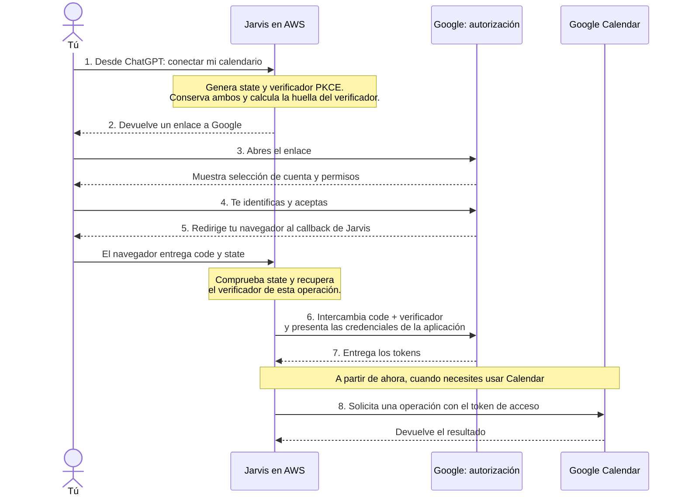

# Conectar Jarvis con Google Calendar: OAuth y PKCE

Guía de estudio del flujo que estamos construyendo. El esquema describe el
comportamiento previsto; todavía no representa una conexión completa implementada.

## 1. Qué estamos intentando conseguir

Desde ChatGPT quieres pedir a Jarvis que gestione tu calendario. Para hacerlo,
Jarvis necesita que autorices el acceso a tu cuenta de Google Calendar.

**OAuth 2.0 permite conceder ese acceso sin entregar a Jarvis tu contraseña de
Google.** Tú introduces la contraseña en Google; Jarvis obtiene una autorización
limitada a los permisos que aceptes. Es un protocolo de autorización: determina a
qué puede acceder una aplicación.

En este caso añadimos **PKCE**, una protección para el intercambio del código de
autorización. No añade ninguna contraseña que debas introducir tú.

Referencia: [OAuth 2.0, RFC 6749](https://www.rfc-editor.org/rfc/rfc6749.html).

## 2. Recorrido completo

Tú interactúas con ChatGPT y con la página de Google. Jarvis se ocupa de los
intercambios internos.



El flujo se llama **Authorization Code**. El código recibido en el callback es
temporal y de un solo uso: todavía no permite consultar Calendar. Nuestro servidor
lo intercambia directamente con Google para obtener los tokens.

Referencia: [Flujo OAuth para aplicaciones de servidor, Google](https://developers.google.com/identity/protocols/oauth2/web-server).

## 3. Conceptos

| Concepto | Qué es y para qué sirve |
| --- | --- |
| OAuth 2.0 | Protocolo para conceder a una aplicación acceso limitado a un servicio. |
| `client_id` | Identificador público de nuestra aplicación registrada en Google. |
| `client_secret` | Credencial privada de esa aplicación. La tenemos en Parameter Store. |
| Scopes | Permisos que solicita Jarvis y que el usuario debe aceptar. |
| Callback / `redirect_uri` | Dirección a la que Google devuelve el navegador tras aceptar o rechazar. |
| `state` | Identificador aleatorio de la solicitud pendiente. Google lo devuelve sin modificar. |
| `code` | Código temporal de un solo uso que genera Google después de autorizar. |
| `code_verifier` | Valor aleatorio privado que genera Jarvis para un intento de conexión. |
| `code_challenge` | Huella del verificador que se envía en la solicitud inicial. |
| Access token | Credencial utilizada para llamar a Calendar. Tiene caducidad. |
| Refresh token | Credencial que permite obtener nuevos access tokens mientras siga siendo válida. |

Referencia: [OAuth 2.0, RFC 6749](https://www.rfc-editor.org/rfc/rfc6749.html).

```text
APLICACIÓN JARVIS
│
├── client_id y client_secret
│   Identifican a nuestra aplicación.
│
├── Cada intento de conectar Calendar
│   ├── state
│   ├── code_verifier → su huella es code_challenge
│   └── code que devuelve Google
│       Son datos temporales de esa operación.
│
└── Cada conexión autorizada por un usuario
    ├── access token
    └── refresh token
        Permiten acceder a su calendario.
```

## 4. Quién genera cada código

**El código de autorización (`code`) lo genera Google.** Lo recibiremos después
de que el usuario acepte. No lo generamos nosotros ni necesitamos guardarlo antes:
aún no existe al preparar el enlace.

**El verificador PKCE (`code_verifier`) lo genera la librería de Jarvis.** En
`src/jarvis/integrations/google_oauth.py` hemos activado:

```python
# Let the library generate a private verifier for this authorization attempt.
autogenerate_code_verifier=True,
```

Cuando llamamos a `flow.authorization_url(...)`, la librería genera el verificador
y su huella. Nuestra función devuelve la URL y `flow.code_verifier` al llamador.
En la prueba local, esto ocurre en tu ordenador. Cuando esa función se utilice
desde la herramienta desplegada, ocurrirá dentro de Lambda. AWS no genera este
valor por su cuenta: ejecuta nuestro código Python y la librería que utilizamos.

Referencia: [Implementación de `Flow`, google-auth-oauthlib](https://googleapis.dev/python/google-auth-oauthlib/latest/_modules/google_auth_oauthlib/flow.html).

**El `state` lo genera nuestro código.** En tu prueba lo construiste con el nombre
de rama y `secrets.token_urlsafe(32)`. El nombre de rama ayuda a identificar el
entorno; la parte aleatoria identifica el intento. Google devuelve el valor,
pero no interpreta ni valida nuestra elección de rama.

## 5. Qué comprueba PKCE

1. Jarvis genera un verificador aleatorio y conserva el original.
2. Calcula su huella y la envía a Google con el enlace de autorización.
3. Después de que aceptes, Google devuelve el código de autorización.
4. Jarvis presenta ese código junto con el verificador original.
5. Google comprueba que la huella del verificador coincide con la inicial antes
   de entregar los tokens.

`S256` indica que se utiliza SHA-256 para calcular la huella. La huella no permite
recuperar de forma práctica el verificador original. Por eso, interceptar el código
de autorización no basta para completar un intercambio protegido con PKCE.

`state` tiene otra función: relacionar y validar la respuesta respecto a la
solicitud pendiente. No sustituye a PKCE. Además, nuestra aplicación debe vincular
correctamente la operación con el usuario de Jarvis; estas comprobaciones no
sustituyen por sí solas esa vinculación.

Referencia: [PKCE, RFC 7636](https://www.rfc-editor.org/rfc/rfc7636.html).

## 6. Por qué hay que conservar datos entre peticiones

**Hay dos peticiones separadas a nuestro servidor.** No necesitamos crear dos
funciones Lambda distintas: una misma función desplegada puede atender ambas
mediante dos invocaciones.

```text
PRIMERA PETICIÓN: desde ChatGPT
│
├── API Gateway invoca Lambda.
├── Jarvis prepara state, verificador y enlace.
├── Conserva la solicitud pendiente fuera de la memoria de esa ejecución.
└── Devuelve el enlace. La invocación termina.

    Tú abres Google, eliges la cuenta y aceptas.
    No dejamos una ejecución de Lambda esperando durante ese tiempo.

SEGUNDA PETICIÓN: tu navegador vuelve desde Google
│
├── API Gateway vuelve a invocar Lambda, ahora para el callback.
├── Llegan el código generado por Google y el state.
├── Jarvis valida la solicitud y recupera el verificador original.
├── Intercambia el código con Google para obtener los tokens.
└── Completa la operación e invalida la solicitud pendiente.
```

Una variable local de Python no conserva la solicitud entre ambas invocaciones.
AWS puede reutilizar un entorno de ejecución, pero no garantiza que la siguiente
petición llegue al mismo. Una variable global tampoco es un almacén fiable para
este proceso.

Referencia: [Ciclo de vida del entorno de ejecución de Lambda, AWS](https://docs.aws.amazon.com/lambda/latest/dg/lambda-runtime-environment.html).

## 7. Por qué propuse DynamoDB

Es una elección para nuestra arquitectura, no una obligación de OAuth.

La aplicación ya tiene DynamoDB. Podemos reutilizarlo para que cualquier ejecución
recupere una solicitud pendiente por su `state`, sin añadir otro servicio.

El registro temporal propuesto contendría:

| Dato | Para qué lo necesita Jarvis |
| --- | --- |
| `state` | Encontrar y validar la solicitud pendiente. |
| Usuario de Jarvis | Saber quién inició la operación. |
| `code_verifier` | Completar el intercambio protegido con PKCE. |
| Caducidad | Rechazar intentos demasiado antiguos. |

No contiene el `client_secret`: esa configuración compartida permanece en
Parameter Store. Tampoco necesita contener el código de Google antes del callback:
ese código llegará en la segunda petición y se utilizará para el intercambio.

La propuesta era permitir diez minutos para completar el intento. Nuestra tabla
ya tiene TTL configurado sobre `expires_at`. TTL limpia registros caducados, pero
no los elimina necesariamente en ese instante: la aplicación también debe comprobar
la caducidad. Una operación completada debe quedar inutilizable para otro intento.

Referencia: [TTL en DynamoDB, AWS](https://docs.aws.amazon.com/amazondynamodb/latest/developerguide/TTL.html).

## 8. Qué ocurre después de conectar

La solicitud pendiente es temporal. Los tokens corresponden a la conexión
autorizada de un usuario y necesitan su propio almacenamiento seguro.

El access token permite llamar a Calendar. El refresh token permite renovarlo
sin pedir que repitas el consentimiento cada vez, mientras siga siendo válido.
Puedes revocar el acceso desde Google. La biblioteca ayuda con el intercambio
y la renovación, pero nuestra aplicación debe conservar las credenciales.

Referencia: [Acceso sin presencia del usuario, Google](https://developers.google.com/identity/protocols/oauth2/web-server#offline).

## 9. Dónde estamos

Ya existe `build_google_authorization(state)`, que prepara la URL y devuelve el
verificador. Tu prueba local comprobó el `state`, el método `S256` y la existencia
del verificador sin imprimir valores privados.

El almacenamiento de solicitudes, la herramienta para iniciar la conexión y el
callback completo siguen pendientes. Este documento no implementa esos cambios.
El esquema simplifica el enrutamiento entre ramas: el callback compartido también
deberá hacer llegar la respuesta al entorno que inició la solicitud; el prefijo
de rama dentro de `state` no realiza ese enrutamiento por sí solo.
